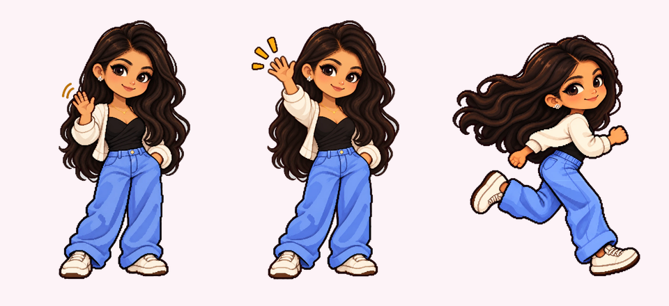

# Cursor Pet

A little cartoon character that lives on the edges of your website, follows your visitor's mouse, and waves hello. 👋



**[▶ Try the live demo](https://YOUR-NAME.github.io/cursor-pet/demo.html)**

## What she does

- **Follows the mouse.** As the cursor moves, she runs along the left or right edge of the page and stays level with it.
- **Keeps her distance.** She always leaves a gap between herself and the cursor, so she never sits under it.
- **Never covers your content.** She only stops in the side margins. Before stopping, she checks the spot and avoids text, images, buttons and form fields.
- **Rests on the opposite side.** When the mouse stops, she lands on the edge opposite the cursor, then waves and blinks.
- **Never blocks clicks.** Clicks pass straight through her.
- **Works anywhere.** All the artwork is transparent PNG, so she fits any background color.
- **Phone friendly.** Touch screens have no cursor, so she rests in a free corner and waves.
- **Respects reduced motion.** If a visitor has turned on "reduce motion" in their system settings, she stays still.

## Add her to your website

1. Copy `pet.js` and the `assets` folder into your website, keeping them together in a `pet` folder:

   ```
   your-website/
     index.html
     pet/
       pet.js
       assets/
   ```

2. Add this line just before `</body>` on any page:

   ```html
   <script src="pet/pet.js"></script>
   ```

That's it. No libraries, no build step.

## Settings

Change her size and the gap from the cursor on the script tag:

```html
<script src="pet/pet.js" data-size="140" data-gap="110"></script>
```

| Setting     | What it does                                   | Default |
|-------------|------------------------------------------------|---------|
| `data-size` | Her height in pixels                           | `140`   |
| `data-gap`  | Space she keeps between herself and the cursor | `110`   |

## Try it on your computer

Some browsers block images on pages opened straight from a file, so run a tiny local server from this folder:

```bash
python -m http.server 8000
```

Then open `http://localhost:8000/demo.html` and move your mouse around.

## How it works

- **Animation:** waving is drawn from four hand-drawn frames. Blinking uses eyelid overlays that close over her eyes. Running is a cut-out puppet whose legs swing from the hips.
- **Movement:** a spring with a little lag gives her smooth, floaty movement, and she tilts in the direction she's running.
- **Finding a spot:** she splits each edge of the screen into slots and checks which ones have content underneath. She then picks a free slot that's away from the cursor and close to its height. She checks again after you scroll or resize the window.

## Files

| File          | What it is                                          |
|---------------|-----------------------------------------------------|
| `pet.js`      | The whole pet: one self-contained script            |
| `assets/`     | Transparent PNG artwork (waving, blinking, running) |
| `demo.html`   | A sample page to try her on                         |
| `preview.png` | The image at the top of this README                 |
